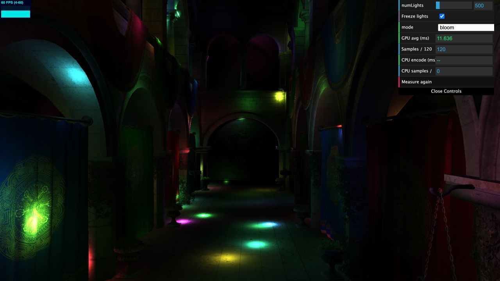
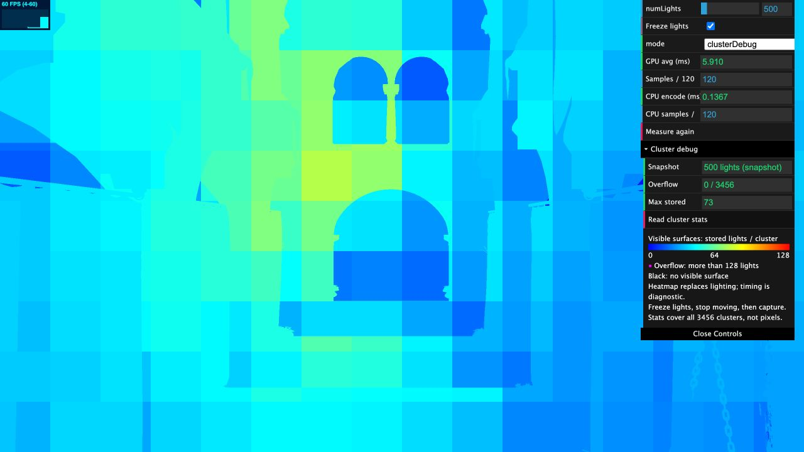
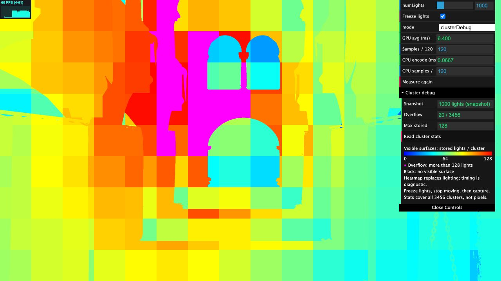
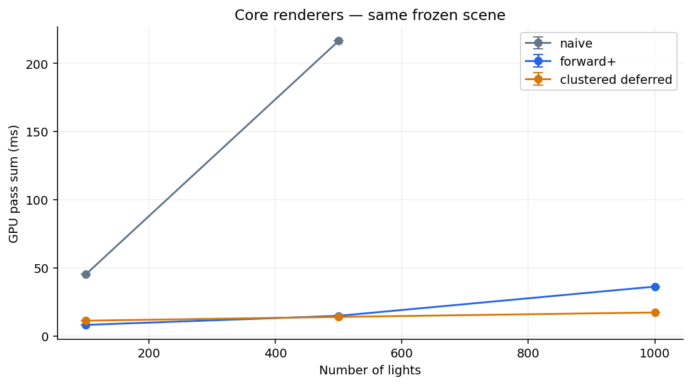
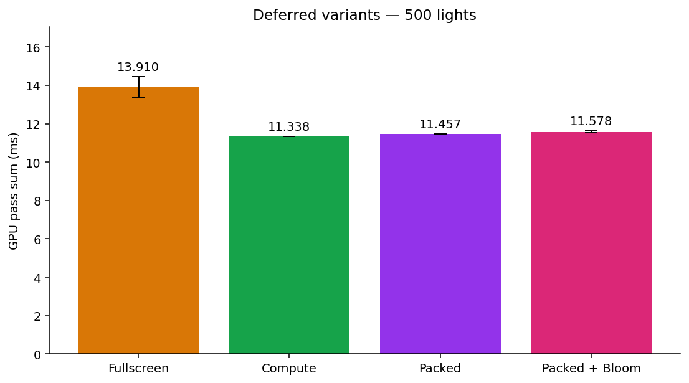
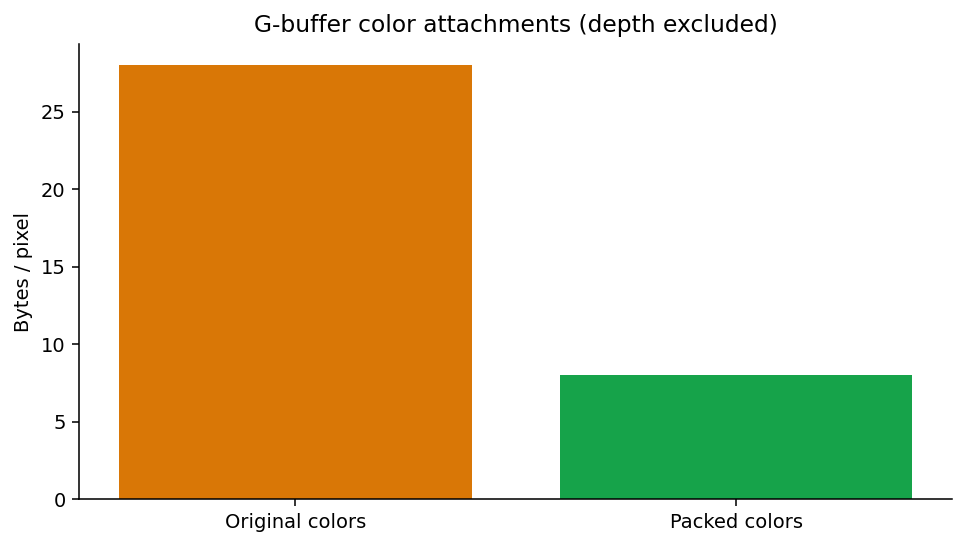
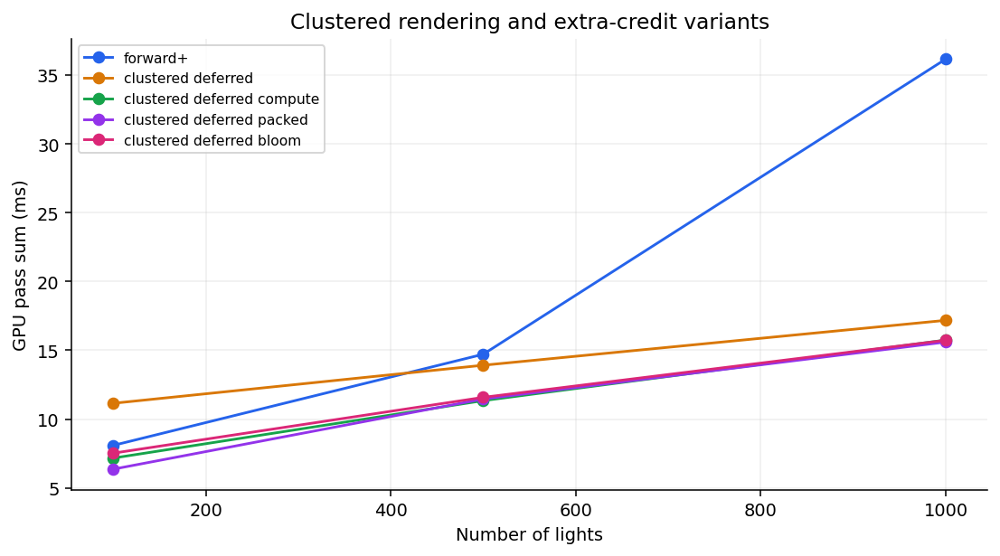
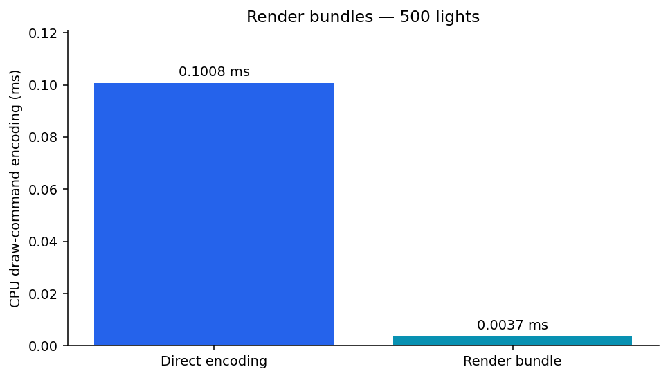

WebGPU Forward+ and Clustered Deferred Shading
======================
**University of Pennsylvania, CIS 565: GPU Programming and Architecture, Project 4**

* Qingying Li
* Tested on: a Chromium-based browser on macOS 26.5,
  MacBook Pro, Apple M1 Pro (8-core CPU, 14-core GPU), 16 GB unified memory.
* Live demo also checked in Google Chrome.

### Live Demo

[Open the live demo](https://HarperLi680.github.io/Project4-WebGPU-Forward-Plus-and-Clustered-Deferred/)

[](https://HarperLi680.github.io/Project4-WebGPU-Forward-Plus-and-Clustered-Deferred/)

Open it in a browser that supports WebGPU. Use the panel in the top-right corner to change the light count, freeze the lights, and switch modes.

### Demo Video

[Watch the demo video on Google Drive](https://drive.google.com/file/d/1_8lNfuAYUaPJu9720G-WGg8DcKaN7WsT/view?usp=sharing)

The video is 2 minutes 19 seconds long and plays at 1.25× speed.

### Features

| Mode | What it does |
| --- | --- |
| `naive` | Forward rendering that checks every light for each fragment. |
| `forwardPlus` | Light clustering in a compute shader, then forward shading with each fragment's cluster light list. |
| `clusteredDeferred` | A geometry pass writes position, normal, and albedo, then a fullscreen pass does the lighting with the cluster light lists. |
| `clusteredDeferredCompute` | Same as above, but the lighting is done in a compute pass instead of a fullscreen render pass. |
| `clusteredDeferredPacked` | Compute lighting with one packed G-buffer texture; position is rebuilt from depth. |
| `bloom` | Packed deferred lighting plus Bloom, done in compute passes. |
| `forwardPlusBundles` | Forward+ using a render bundle for the scene draws. |
| `clusterDebug` | Colors each visible surface by how many lights its cluster has. |

Extra credit: compute lighting pass, G-buffer packing, Bloom, and render bundles.

### Light Clustering

I split the view frustum into a **16 × 9 × 24** grid, with depth slices spaced logarithmically. One compute thread handles one cluster: it builds the cluster's bounding box in view space and checks which lights touch it. When shading, each fragment finds its cluster and only loops over that cluster's lights.

Each cluster stores up to **128 light indices**. If more lights touch a cluster, I mark it as overflowed and the shader falls back to checking all lights, so no light gets dropped. The downside is that this fallback is slow.

### Cluster Debug View

The `clusterDebug` mode shows how many lights each cluster stores. Blue to red means **0 to 128 lights**, and **magenta means the cluster overflowed** (more than 128 lights). Black is background. With the lights frozen, clicking **Read cluster stats** reads the cluster buffer back to the CPU and counts overflowing clusters across the whole 3456-cluster grid.

Both images use the same camera and the same frozen lights; only the light count changes.

| Lights | Overflowing clusters | Max lights stored |
| --- | ---: | ---: |
| 500 | 0 / 3456 | 73 |
| 1000 | 20 / 3456 | 128 (cap) |





[Snapshot data](performance/cluster-debug-snapshots.json)

At 500 lights most clusters are blue or cyan, so most fragments only check a few dozen lights. At 1000 lights most of the screen turns orange or red, and a large magenta area in the middle falls back to checking all 1000 lights. Only 20 clusters overflow, but in this view they cover a large part of the middle of the screen.

When a cluster overflows, its fragments have to check every light, so I think this adds a lot of lighting work at 1000 lights, especially for Forward+, which can shade the same pixel more than once. These screenshots come from a different session than the timing runs below, so they show where the extra cost comes from but don't measure it.

### Performance Analysis

#### Setup

- Production build, Sponza, **2560 × 1440** canvas, light radius **2**.
- Same camera and frozen lights for every run.
- Each GPU run: 30 warmup frames, then the average of 120 timestamp samples. I ran each optimized mode twice at 500 lights and once for the other cases.
- GPU time is the sum of the clustering, rendering, and Bloom passes. CPU time only covers encoding the scene draws (or `executeBundles()`).

[Raw run averages](performance/measurements.csv) · [Summary with run ranges](performance/summary.csv)

#### Forward+ vs. Clustered Deferred

GPU milliseconds, lower is better.

| Lights | Naive | Forward+ | Clustered Deferred |
| --- | ---: | ---: | ---: |
| 100 | 45.046 | 8.086 | 11.145 |
| 500 | 216.415 | 14.7075 | 13.910 |
| 1000 | Not measured | 36.155 | 17.172 |



Both clustered renderers are much faster than Naive, because each fragment only checks the lights near it instead of all of them. At 500 lights, Naive takes 216 ms, while Forward+ and Deferred both take about 14 ms.

Forward+ is faster with few lights. At 100 lights it takes 8.1 ms versus 11.1 ms for Deferred, because it skips the G-buffer pass and the extra texture writes and reads. With more lights Deferred wins: at 1000 lights it takes 17.2 ms versus 36.2 ms for Forward+. Deferred only lights the visible surface, once per pixel. Forward+ can also light fragments that get covered later by other geometry, and that extra work grows as the light lists get longer.

So Forward+ is the better choice for scenes with few lights or transparent objects, since it doesn't need a G-buffer. Deferred is better for many lights and lots of overlapping geometry, but it uses more memory and can't handle transparency directly.

The cluster grid size also matters. Smaller clusters give shorter light lists but more clusters to build. A larger light radius makes the lists longer and causes more overflow.

#### Compute lighting and packed G-buffer

The compute lighting version runs **8 × 8 workgroups**, one thread per pixel, reads the G-buffer, and writes the result to a storage texture.

The packed version uses one **`rg32uint`** texture:

- One `u32` holds the normal, octahedral-encoded with `pack2x16snorm`.
- One `u32` holds the albedo with `pack4x8unorm`.
- World position is rebuilt from depth and the inverse view-projection matrix.

| Deferred version | 100 lights | 500 lights | 1000 lights |
| --- | ---: | ---: | ---: |
| Fullscreen lighting | 11.145 | 13.910 | 17.172 |
| Compute lighting | 7.164 | 11.3375 | 15.737 |
| Packed compute lighting | 6.359 | 11.457 | 15.595 |
| Packed compute + Bloom | 7.521 | 11.5775 | 15.725 |



Switching to compute lighting saved the most time: about 4 ms at 100 lights and 2.6 ms (18.5%) at 500 lights. Packing helped at 100 lights (7.16 → 6.36 ms) but made almost no difference at 500 and 1000 lights. I think this is because with more lights, the lighting itself takes up more of the time, so a smaller G-buffer matters less.

Packing cuts the color data from **28 bytes per pixel** (`rgba32float` position, `rgba16float` normal, `rgba8unorm` albedo) to **8 bytes**, a **71.4%** drop. At 2560 × 1440 that is 98.44 MiB down to 28.13 MiB, plus a 14.06 MiB `depth32float` depth texture. The cost is some precision loss and extra math to decode the normal and rebuild the position. Packing helps most when the G-buffer reads are the bottleneck, such as high resolutions with few lights. To push it further, I would try different workgroup sizes and a visibility buffer.



### Bloom

Bloom uses four compute passes: extract bright pixels at half resolution, blur horizontally, blur vertically, and add the result back. The Gaussian blur has radius **8** and sigma **4**, with a brightness threshold of **0.6** and strength **0.6**.

Splitting the blur into two 17-tap passes takes 34 samples per pixel instead of 289 for a full 17 × 17 kernel, and running it at half resolution cuts the pixel count by 4.

Bloom adds about **0.12–0.13 ms** at 500 and 1000 lights and 1.16 ms at 100 lights. Its cost depends on resolution and blur radius, not on the light count, so it is a small share of the frame when lighting is expensive. The half-resolution blur loses a little fine highlight detail. It could be made faster by loading pixels into workgroup shared memory so neighboring threads don't read the same texels again.



### Render Bundles

The bundle records the Forward+ scene's bind groups and draw calls once, then replays them every frame with `executeBundles()`. The camera and light buffers can still change without re-recording.

| Lights | Direct CPU encoding (ms) | Bundle CPU encoding (ms) | Direct GPU (ms) | Bundle GPU (ms) |
| --- | ---: | ---: | ---: | ---: |
| 100 | 0.1725 | 0.0025 | 8.086 | 7.721 |
| 500 | 0.1008 | 0.00375 | 14.7075 | 14.797 |
| 1000 | 0.3700 | 0.0058 | 36.155 | 40.208 |



Bundles cut the CPU encoding time from about 0.1–0.37 ms to under 0.01 ms, while GPU time stayed about the same. The bundle version was about 4 ms slower at 1000 lights. I think this is just run-to-run variation, since bundles only save CPU work and the GPU still does the same shading.

The best case is a static scene with many draw calls, where CPU encoding is a real cost. The worst case is a GPU-bound scene like this one: encoding Sponza's draws only takes 0.1–0.4 ms in the first place, so the saving is tiny next to 8–36 ms of GPU time. Bundles also have to be re-recorded when geometry or pipelines change.

### Testing

`npm run build` passes, and all modes run in the production build with no WebGPU errors. With the camera and lights fixed, Naive and Forward+ give the same image, Forward+ with and without bundles give the same image, and fullscreen and compute Deferred give the same image. The packed G-buffer gives a very slightly different image because the normals and colors are stored with fewer bits.

### Running Locally

```bash
npm install
npm run dev
```

Build for deployment:

```bash
npm run build
```

The GitHub Actions workflow builds and deploys the site when changes are pushed to `main`.

### Credits

- [Vite](https://vitejs.dev/)
- [loaders.gl](https://loaders.gl/)
- [dat.GUI](https://github.com/dataarts/dat.gui)
- [stats.js](https://github.com/mrdoob/stats.js)
- [wgpu-matrix](https://github.com/greggman/wgpu-matrix)
